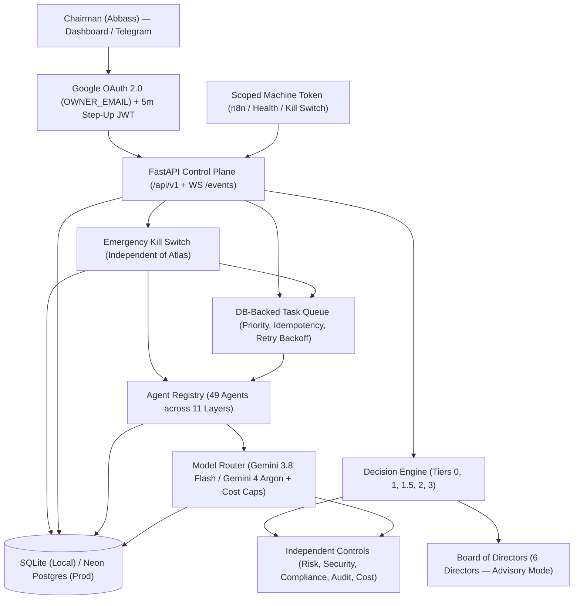

# Atlas AI Architecture (`v0.1.0` — Phase 0 Foundation)

## 1. System Overview

**Atlas AI** is a personal, single-owner multi-agent operating system designed for **Abbass (Chairman)**. Atlas (the CEO agent) coordinates 49 specialized agents across 11 operational layers, operating autonomously within deterministic risk and budget boundaries and escalating high-impact decisions to the Chairman.

## 2. Core Architectural Invariants

1. **No Direct Inter-Agent Calls**: Agents never call each other directly. All work is scheduled and dispatched through Atlas and the durable DB-backed `TaskQueueService` (`core/task_queue.py`).
2. **Independent Emergency Kill Switch**: `POST /api/v1/kill-switch` (`core/kill_switch.py`) operates directly against the database and `AgentRegistry` without depending on the Atlas CEO agent. Even if Atlas is offline or unresponsive, the kill switch immediately halts all active agents, cancels pending jobs, and locks the system in read-only `SAFE` mode.
3. **Tamper-Evident Append-Only Audit Log**: Every login, token refresh, step-up verification, permission denial, task execution, budget alert, and kill-switch event is recorded in `audit_log` (`core/audit.py`). Each record stores `prev_hash` and `entry_hash` (SHA-256). SQLAlchemy ORM `before_update` and `before_delete` hooks unconditionally raise `AuditTamperError`.
4. **Fail-Closed Model Router & Pre-Call Cost Enforcement**:
   - Per-agent LLM settings are loaded from [`core/model_router.yaml`](../core/model_router.yaml).
   - Every LLM call is checked against the Cost Agent caps **before** dispatch ($5/day global, $100/month global, $1/day Board, 30% single-agent daily share cap, 80% soft alert, 100% hard stop, max 10 LLM calls per task).
   - In production (`ENV=prod`), if `GEMINI_API_KEY` is missing, the router fails closed (`ProviderUnavailableError`). Mock output (`mock=True`) is restricted to `ENV=dev` / `ENV=test` and can never authorize Tier 1 or Tier 1.5 execution.
5. **Single-Owner Zero-Trust Authentication**:
   - **Dashboard Login**: Verifies Google OAuth 2.0 ID token signature, audience (`GOOGLE_CLIENT_ID`), expiry, and `email_verified=true`, and enforces exact match against `OWNER_EMAIL`. Issues a 15-minute HS256 JWT access token and a revocable SHA-256-hashed 7-day refresh token.
   - **Step-Up Verification**: Resuming from `SAFE` mode, editing the Charter, changing budget limits, promoting agent autonomy, and approving real-money actions require a fresh Google authentication within the last 5 minutes (`step_up_at` claim).
   - **Scoped Machine Token**: `MACHINE_API_TOKEN` is compared in constant time via SHA-256 hash and is restricted strictly to `read:status`, `read:health`, `create:low_tier_task` (Tier 0/1 only), and `execute:kill_switch`.
